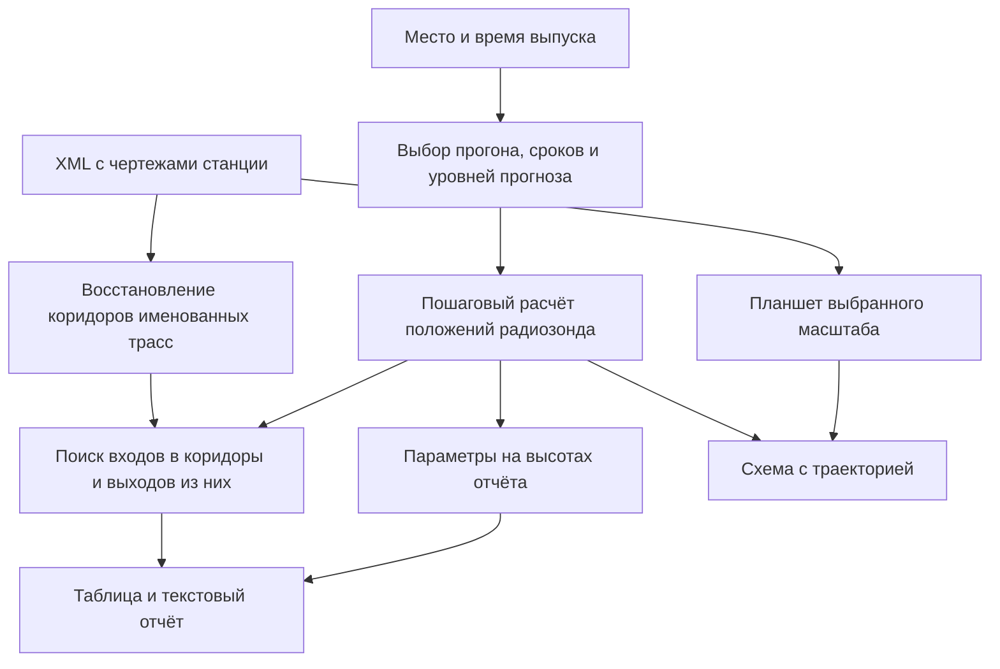

# Построение траектории радиозонда и расчёт её параметров

В документе описан реализованный в программе расчёт подъёма радиозонда: исходные
планшеты воздушных трасс, масштабы 50 и 100 км, выбор метеорологических данных,
пошаговое построение траектории, параметры таблицы перемещения и пересечения трасс.
Формулы и ограничения соответствуют текущему коду программы.

## 1. Общая последовательность

Программа прогнозирует положение радиозонда по мере его подъёма в поле ветра.
Задаются место и время выпуска; из файлов прогноза выбираются ветер и температура.
Затем рассчитывается последовательность положений зонда от выпуска до верхней
высоты отчёта. Полученный путь наносится на планшет станции и проверяется на
прохождение через коридоры воздушных трасс.



Расчёт перемещения выполняется на сервере. Браузер получает готовые координаты
пути и строки таблицы. Выбор масштаба меняет представление схемы, а не физическую
траекторию.

## 2. Исходные параметры и принятая модель движения

| Параметр | Назначение и правило использования |
|---|---|
| Станция | Определяет координаты выпуска и исходный планшет |
| Произвольные широта и долгота | Задают точку выпуска вместо координат станции; при одновременной передаче имеют приоритет |
| Время выпуска | Начальный момент расчёта; время в отчётах показывается в UTC |
| Прогон модели | Обычно выбирается автоматически; API позволяет указать его явно |
| Скорость подъёма `w` | Постоянная вертикальная скорость; по умолчанию 5 м/с |
| Способ горизонтальной выборки | `nearest` — ближайший узел, по умолчанию; `bilinear` — билинейная интерполяция |
| Шаг интегрирования | По умолчанию 10 с; задаётся настройкой сервера `STEP_SECONDS` |
| Масштаб планшета | 10 или 5 км на деление, то есть радиус 100 или 50 км |

Скорость подъёма по умолчанию настраивается через `ASCENT_RATE_MS`, а для отдельного
запроса — через `ascent`. В сервисе положительное значение ограничивается диапазоном
1–15 м/с; неположительное заменяется на 5 м/с. Нечисловое значение `ascent`
отклоняется при разборе запроса. В обычной форме сайта отдельного поля для изменения
скорости и режима интерполяции нет.

Вертикальное движение задаётся формулой:

```text
h(t) = w · t,
```

где `h` — расчётная высота в метрах, `t` — время после выпуска в секундах.
В точке выпуска принимается `h = 0`. Высота станции над уровнем моря в этот расчёт
не добавляется.

Горизонтальное движение определяется только ветром. Вертикальная скорость воздуха,
ускорение зонда, изменение скорости подъёма с высотой, разрыв оболочки и последующий
спуск в данной модели не рассчитываются. Температура записывается в результаты,
но непосредственно на перенос зонда и скорость его подъёма не влияет.

## 3. Как изначально хранятся карты воздушных трасс

### 3.1. Файлы планшетов

Исходная схема каждой станции находится в отдельном файле `stations/*.xml`.
Файлы имеют кодировку Windows-1251. В текущем каталоге 106 XML-файлов, из которых
105 описывают доступные станции; `XXXXX.xml` — заготовка без координат.

Планшет хранится как векторный чертёж: последовательности точек, соединяемых
прямыми отрезками, и текстовые подписи. Координаты этих точек заданы в единицах
исходного холста, а не широтой и долготой.

Основные элементы XML:

| Элемент | Содержание |
|---|---|
| `Point` | Код и название станции, широта, долгота, индекс ВМО, АМЦ/АМСГ и другие атрибуты |
| `Scale` | Чертёж одного масштаба; `Value` задаёт километры на деление |
| `Polyline` | Ломаная исходного чертежа; `ps="Dot"` означает пунктир |
| `Airway` | Именованная ломаная границы или участка коридора трассы |
| `Label` | Текст, положение и угол поворота подписи |
| `point` | Одна точка ломаной с координатами `x`, `y` |

Например, в планшете Архангельска одна из границ трассы Л93 записана так:

```xml
<Airway Caption="Л93-1">
  <point x="212" y="201"/>
  <point x="265" y="258"/>
  <point x="294" y="291"/>
  <point x="326" y="328"/>
</Airway>
```

Суффикс `-1` обозначает отдельный фрагмент чертежа. Для расчёта коридора фрагменты
`Л93-1`, `Л93-2` и другие с тем же базовым названием рассматриваются совместно.
Один элемент `Airway` сам по себе не обязательно задаёт замкнутую область.

### 3.2. Чтение и подготовка

При запуске сервер читает XML-файлы, переводит текст из Windows-1251, разбирает
координаты станции с десятичной запятой и создаёт объекты геометрии в памяти.
Для каждого масштаба отдельно сохраняются линии, именованные участки трасс и подписи.

Угол `Label.angle` хранится в десятых долях градуса: например, `-800` соответствует
`-80°`. Исходное направление отсчёта угла учитывается при переводе в поворот SVG.
Числовые XML-ссылки на символы также раскрываются.

Повторяющиеся блоки `Scale` с одинаковым `Value` объединяются. Линии с менее чем
двумя корректными точками и пустые подписи отбрасываются. Станции без координат
или без планшетов не включаются в рабочий список. Отдельные станции имеют только
один из двух масштабов; отсутствующий чертёж автоматически не создаётся из другого.

Исходные файлы уже содержат подготовленную геометрию трасс. Программа не вычисляет
её из навигационных точек и не загружает заново при каждом расчёте траектории.

## 4. Что означают масштабы 50 и 100 км

Оба планшета используют квадратный холст 536 × 536 условных пикселей. Центр станции
расположен в точке `(268; 268)`, внешний радиус равен 268 единицам холста.
По радиусу нанесено 10 делений.

| Параметр | Планшет «100 км» | Планшет «50 км» |
|---|---:|---:|
| Значение `Scale.Value` в XML | 10 | 5 |
| Расстояние между кольцами | 10 км | 5 км |
| Радиус внешнего кольца | 100 км | 50 км |
| Диаметр внешнего кольца | 200 км | 100 км |
| Радиус пятого, выделенного кольца | 50 км | 25 км |
| Единиц холста на километр | 2,68 | 5,36 |

Таким образом, название «100 км» означает расстояние от центра до внешнего кольца.
Это не диаметр и не запись масштаба вида `1 : N`.

При числе колец `N = 10` и цене деления `s`:

```text
R = N · s,
k = 268 / R,
```

где `R` — радиус в километрах, `k` — число единиц холста на километр.

Переход от смещения относительно станции к точке на планшете:

```text
x = 268 + k · dx,
y = 268 − k · dy,
```

где `dx` — смещение к востоку, `dy` — к северу, оба в километрах. Знак минус
у `dy` связан с тем, что экранная координата `y` растёт вниз.

Обратное преобразование:

```text
dx = (x − 268) / k,
dy = (268 − y) / k.
```

Например, точка в 10 км к востоку от станции имеет координаты `(294,8; 268)`
на планшете 100 км и `(321,6; 268)` на планшете 50 км.

Чертежи двух масштабов хранятся независимо: планшет 50 км не получается простым
увеличением всех линий планшета 100 км. При этом одна и та же рассчитанная траектория
переводится в координаты каждого из планшетов с соответствующим коэффициентом `k`.

## 5. Как строится изображение карты трасс

Сначала программно создаётся координатная основа: десять концентрических колец,
направления сторон света, оси и угловые отметки. Расстояние между соседними кольцами
на исходном холсте равно `268 / 10 = 26,8` единицы.

На экранной схеме радиальные линии проводятся через 30°, засечки по окружности —
через 5°. На печатном бланке сохраняются основные оси С–Ю и З–В, засечки наносятся
через 10°. Пятое кольцо выделяется толщиной; на экране также выделено внешнее кольцо.

На эту основу наносятся линии из XML. Если в чертеже есть `Polyline`, именно они
используются для изображения геометрии. `Airway` при этом служат для расчёта коридоров
и автоматических подписей; их линии повторно не рисуются. Если `Polyline` отсутствуют,
отображаются линии `Airway`.

Далее наносятся готовые подписи `Label`. На экранной схеме для трассы без готовой
подписи может добавляться автоматическая: выбирается самый длинный фрагмент трассы,
а внутри него — самый длинный отрезок; название размещается в его середине вдоль линии.
В печатном варианте по умолчанию сохраняются исходные подписи XML.

В имеющихся данных именованные `Airway` находятся в масштабе 10 км на деление.
В масштабе 5 км на деление трассы представлены обычными линиями и текстом.
Поэтому расчёт пересечений использует чертёж с именованными `Airway`, обычно планшет
радиусом 100 км, независимо от масштаба, выбранного для просмотра.

Поверх чертежа проводится ломаная рассчитанного пути, обозначается точка выпуска
и ставятся пронумерованные маркеры на высотах отчёта. Номера маркеров совпадают
с номерами строк таблицы.

Экранная схема и скачиваемый бланк используют общий генератор SVG. В печатном
варианте чертёж и траектория обрезаются по внешнему кольцу. Такая обрезка относится
только к изображению: расчёт пути продолжается до верхней высоты отчёта.
Для PNG браузер растеризует готовый SVG с сервера. Зум и перемещение схемы на экране
не меняют результаты вычислений.

## 6. Откуда берутся ветер и температура

### 6.1. Организация файлов

Данные прогноза организованы по прогонам модели. Имя каталога имеет вид
`ГГГГММДДЧЧ`, например `2026080700` — прогон от 07.08.2026, 00:00 UTC.
Внутри лежат отдельные файлы для сочетаний уровня давления и заблаговременности:

```text
2026080700/
  mb_850_fcst_006.bin
  mb_850_fcst_009.bin
  mb_300_fcst_006.bin
  ...
```

`mb_300_fcst_006.bin` содержит поле на 300 гПа для срока +6 ч от начала прогона.
Программа читает собственное упакованное двоичное представление полей из источника
прогноза; универсальный разбор произвольного файла GRIB2 здесь не выполняется.

### 6.2. Сетка и упакованные значения

Сетка имеет шаг 1,25° по широте и долготе: 288 × 145 узлов. Широты идут от −90°
до +90°, долготы — от 0° до 358,75°. На один узел отведено 4 байта, поэтому
размер одного поля составляет `288 · 145 · 4 = 167 040` байт.

| Байты узла | Содержание |
|---|---|
| 0 | Модуль температуры в °C |
| 1–2 | Двухбайтовое число: направление ветра и бит знака температуры; старший байт читается первым |
| 3 | Скорость ветра в м/с |

При обозначении двухбайтового числа через `q`:

```text
D = q & 1023,
T = +байт0, если установлен бит 1024,
T = −байт0, если этот бит не установлен,
V = байт3.
```

`D` — метеорологическое направление, то есть откуда дует ветер. В исходных узлах
температура, направление и скорость имеют целочисленную точность; интерполяция
может дать дробные значения.

## 7. Как выбираются прогон и срок прогноза

**Прогон** — набор полей от одного начального времени модели. **Срок** —
заблаговременность конкретного поля внутри этого прогона.

При автоматическом выборе берётся самый свежий прогон, период действия которого
включает время выпуска зонда. Период прогона начинается за 1,5 ч до первого
доступного срока и заканчивается через 1,5 ч после последнего. Левая граница
включается, правая — нет. Если подходящего прогона нет, расчёт завершается сообщением
об отсутствии данных и выдаёт доступные периоды.

При явном указании прогона проверяется его наличие. Если время выпуска выходит
за его период действия, расчёт возможен с предупреждением и использованием
крайнего срока. В течение одного подъёма выбранный прогон не меняется.

При обычном шаге сроков 3 ч каждый срок действует в пределах ±1,5 ч:

| Срок от начала прогона | Период использования |
|---|---|
| +6 ч | от +4 ч 30 мин включительно до +7 ч 30 мин |
| +9 ч | от +7 ч 30 мин включительно до +10 ч 30 мин |
| +12 ч | от +10 ч 30 мин включительно до +13 ч 30 мин |

Граница принадлежит следующему сроку. Если соседние доступные сроки `s₁` и `s₂`
разделены большим промежутком, граница проходит посередине:

```text
sграницы = (s₁ + s₂) / 2.
```

Например, при отсутствии +9 ч между +6 и +12 ч переключение происходит на +9 ч.
Значения ветра разных сроков по времени не смешиваются.

Для каждого шага движения срок выбирается по моменту полёта. Поэтому при пересечении
границы периода в процессе подъёма меняется используемое поле. Например, для прогона
00:00 UTC при выпуске в 07:20 UTC переход от +6 к +9 ч приходится на десятую минуту
подъёма; при скорости 5 м/с это высота 3000 м.

Выбор учитывает файлы, имеющиеся у каждого уровня. Если файл отсутствует или не
читается, используются оставшиеся доступные поля; полностью недоступный уровень
исключается с предупреждением. Периоды `stepPeriods` и список `usedSteps` в ответе
описывают расписание по общему списку сроков прогона. При неполных данных отдельных
уровней это не подробный журнал фактических выборок каждого файла.

Если подъём продолжается после конца действия прогона, для соответствующих уровней
используются последние доступные сроки; программа добавляет предупреждение.

## 8. Уровни прогноза и высоты отчёта

### 8.1. Высоты изобарических уровней

В программе задана таблица соответствия давления и эшелона `FL`. Расчётная высота
уровня определяется по принятому в проекте правилу:

```text
hуровня = FL · 30 м.
```

| Давление, гПа | FL | Расчётная высота, м |
|---:|---:|---:|
| 850 | 50 | 1500 |
| 750 | 80 | 2400 |
| 700 | 100 | 3000 |
| 600 | 140 | 4200 |
| 500 | 180 | 5400 |
| 450 | 210 | 6300 |
| 400 | 240 | 7200 |
| 350 | 270 | 8100 |
| 300 | 300 | 9000 |
| 275 | 320 | 9600 |
| 250 | 340 | 10 200 |
| 225 | 360 | 10 800 |
| 200 | 390 | 11 700 |
| 175 | 410 | 12 300 |
| 150 | 450 | 13 500 |
| 125 | 480 | 14 400 |
| 100 | 530 | 15 900 |

Высоты берутся именно из этого соответствия. Пересчёт высоты из давления по
температурному профилю или геопотенциалу в алгоритме траектории отсутствует.

### 8.2. Высоты строк бланка

Для отчёта используется отдельная фиксированная лестница:

```text
1500, 3000, 5000, 7000, 9000, 12 000, 16 000 м.
```

Она не обязана совпадать с высотами изобарических уровней. Если верхняя высота
в каталоге прогона равна `hmax`, в отчёт включаются строки, удовлетворяющие условию:

```text
H ≤ hmax + 600 м.
```

Допуск 600 м, в частности, позволяет построить строку 16 000 м по верхнему уровню
15 900 м. При четырёх уровнях 850, 700, 500 и 300 гПа верхняя высота равна 9000 м;
отчёт содержит пять строк, до 9000 м, и предупреждение об укорочении.

Высоты отчёта выбираются до чтения самих полей, по составу каталога. Если затем
верхний уровень исключается из-за ошибок чтения, лестница повторно не обрезается:
для расчёта остаются доступные уровни и предупреждения о пропусках.

### 8.3. Выбор уровня на текущей высоте

Для высоты зонда выбирается уровень с наименьшим абсолютным расстоянием по высоте:

```text
j = argmin |h − hⱼ|.
```

При равном расстоянии используется нижний из двух уровней. Ниже самого нижнего
и выше самого верхнего используется крайний доступный уровень. Между уровнями
ветер и температура по высоте не интерполируются.

Например, между уровнями 1500 и 3000 м граница выбора проходит на 2250 м.
До этой высоты включительно берётся нижний уровень, выше — верхний.
Использование нижнего уровня до самой земли означает сохранение именно источника
данных: при изменении положения или времени значение из этого поля может меняться.

## 9. Как выбирается ветер внутри горизонтальной сетки

### 9.1. Ближайший узел

Долгота приводится к диапазону `[0°; 360°)`. Для точки с широтой `φ` и долготой `λ`
в градусах вычисляются индексы:

```text
ix = round(λ · 0,8),
iy = round((φ + 90) · 0,8),
offset = (iy · 288 + ix) · 4.
```

При обращении к данным индекс долготы оборачивается по модулю 288, а индекс широты
ограничивается диапазоном 0–144. Из одного узла берутся готовые `T`, `D`, `V`.

### 9.2. Билинейная интерполяция

Определяются четыре окружающих узла и относительное положение внутри ячейки:

```text
fx = λ · 0,8,
fy = (φ + 90) · 0,8,
tx = fx − x₀,
ty = fy − y₀.
```

Для обычной внутренней ячейки `x₀ = floor(fx)`, `y₀ = floor(fy)`; у полюсов
индексы ограничиваются допустимыми значениями. Веса четырёх узлов:

```text
a₀₀ = (1 − tx)(1 − ty),
a₁₀ = tx(1 − ty),
a₀₁ = (1 − tx)ty,
a₁₁ = tx · ty.
```

Температура рассчитывается как взвешенная сумма. Ветер сначала переводится
в восточную и северную компоненты, затем интерполируются эти компоненты:

```text
T = Σ aᵢ · Tᵢ,
u = Σ aᵢ · uᵢ,
v = Σ aᵢ · vᵢ.
```

Направления ветра в градусах напрямую не усредняются: например, для направлений
359° и 1° прямое среднее дало бы ошибочные 180°. Векторный расчёт учитывает
циклическую природу направления.

## 10. Пошаговое построение траектории

### 10.1. Компоненты ветра

Из метеорологического направления `D` и скорости `V` получаются компоненты
горизонтального переноса:

```text
u = −V · sin D,
v = −V · cos D.
```

При вычислении синуса и косинуса градусы переводятся в радианы. Компонента `u`
положительна к востоку, `v` — к северу.

Например, западный ветер `D = 270°` переносит зонд на восток, а южный `D = 180°` —
на север. Направление переноса противоположно направлению, откуда дует ветер.

Обратный переход, используемый после интерполяции:

```text
V = sqrt(u² + v²),
D = norm(atan2(−u, −v) · 180 / π),
```

где `norm` приводит угол к диапазону `[0°; 360°)`. При скорости менее `10⁻⁹` м/с
функция возвращает нулевую скорость и условное направление 0°.

### 10.2. Длительность шага

Сначала рассчитывается участок от текущей высоты до следующей высоты отчёта `H`:

```text
Δtслоя = (H − h) / w,
n = max(1, ceil(Δtслоя / Δtзаданный)),
dt = Δtслоя / n.
```

Все `n` шагов этого участка имеют одинаковую длительность `dt`, не превышающую
заданный шаг. Благодаря этому последний шаг попадает точно на требуемую высоту.
После участка высота явно приравнивается к `H`, чтобы убрать накопление ошибки
вычислений с плавающей точкой.

При скорости 5 м/с и шаге 10 с высота за обычный шаг увеличивается на 50 м.
Для других скоростей или настроек фактический `dt` может быть немного меньше 10 с.

### 10.3. Выбор данных на шаге

Для каждого шага определяются высота и момент в середине шага:

```text
hср = hₙ + w · dt / 2,
tср = tвыпуска + tₙ + dt / 2.
```

На высоте `hср` выбирается ближайший уровень, для момента `tср` — действующий срок.
Значение ветра берётся в текущем горизонтальном положении зонда `Pₙ`.

Середина используется по высоте и времени; отдельное предварительное положение
зонда в пространственной середине шага не вычисляется. Поэтому называть эту схему
полноценным методом Рунге — Кутты второго порядка было бы неточно.

Горизонтальное перемещение за шаг:

```text
Δx = u · dt,
Δy = v · dt,
```

где перемещения выражены в метрах. Затем обновляются координаты, время и высота:

```text
Pₙ₊₁ = offset(Pₙ, Δx, Δy),
tₙ₊₁ = tₙ + dt,
hₙ₊₁ = hₙ + w · dt.
```

Ветер заново выбирается на следующем шаге. Границы смены уровня или срока
не выделяются отдельным дроблением шага: весь шаг использует выборку для своей
середины по высоте и времени.

### 10.4. Обновление широты и долготы

Для одного короткого шага используется локальное приближение на сфере радиуса
`RЗ = 6371,0088 км`. Число метров в градусе широты:

```text
C = RЗ · 1000 · π / 180.
```

Если широта и долгота выражены в градусах:

```text
φₙ₊₁ = φₙ + Δy / C,
λₙ₊₁ = λₙ + Δx / (C · max(cos(φₙ · π / 180), 10⁻⁶)).
```

Косинус берётся по широте начала шага. Ограничение снизу предотвращает деление
на ноль вблизи полюсов. Само приближение не становится от этого точной полярной
геодезической моделью.

После каждого шага в массив `path` записываются широта, долгота, высота, время
от выпуска и смещение от точки выпуска. В начале массива всегда находится точка
с высотой и временем 0. Между соседними точками при отрисовке проводится отрезок.

## 11. Вычисление параметров перемещения

### 11.1. Время подъёма

Для высоты отчёта `Hᵢ` полное время от выпуска:

```text
tᵢ = Hᵢ / w секунд,
timeMinᵢ = Hᵢ / (60w) минут.
```

Время подъёма между предыдущей и текущей высотой:

```text
layerTimeMinᵢ = (Hᵢ − Hᵢ₋₁) / (60w),   H₀ = 0.
```

При скорости 5 м/с получается:

| Высота, м | Время от выпуска, мин:с | Время в слое, мин:с |
|---:|---:|---:|
| 1500 | 5:00 | 5:00 |
| 3000 | 10:00 | 5:00 |
| 5000 | 16:40 | 6:40 |
| 7000 | 23:20 | 6:40 |
| 9000 | 30:00 | 6:40 |
| 12 000 | 40:00 | 10:00 |
| 16 000 | 53:20 | 13:20 |

Сроки прохождения в абсолютном времени получаются прибавлением этого времени
к моменту выпуска. `totalTimeMin` — время последней строки, `topHeightM` —
последняя выбранная высота отчёта.

### 11.2. Удаление от точки выпуска

Удаление рассчитывается по широте и долготе как кратчайшее расстояние по поверхности
сферы. Для начальной точки `(φ₀, λ₀)` и текущей `(φᵢ, λᵢ)`:

```text
a = sin²((φᵢ − φ₀) / 2)
    + cos φ₀ · cos φᵢ · sin²((λᵢ − λ₀) / 2),
dᵢ = 2RЗ · asin(min(1, sqrt(a))).
```

В этих формулах углы выражены в радианах, результат `dᵢ` — в километрах.
Поле результата называется `distanceKm`.

Удаление характеризует расстояние от выпуска до текущей точки. Оно может уменьшаться,
если ветер переносит зонд обратно в сторону места выпуска.

### 11.3. Азимут

Азимут — начальный истинный пеленг из точки выпуска на текущее положение зонда:

```text
Y = sin(λᵢ − λ₀) · cos φᵢ,
X = cos φ₀ · sin φᵢ − sin φ₀ · cos φᵢ · cos(λᵢ − λ₀),
Aᵢ = norm(atan2(Y, X) · 180 / π).
```

Азимут отсчитывается от севера по часовой стрелке: 0° — север, 90° — восток,
180° — юг, 270° — запад. Это направление от начала на точку, а не направление
местного ветра и не направление последнего отрезка пути.

Для показа румба азимут округляется до ближайшего из 16 направлений через 22,5°:
С, ССВ, СВ и так далее.

### 11.4. Восточное и северное смещения

Из расстояния и азимута получаются координаты для планшета:

```text
dxKm = dᵢ · sin Aᵢ,
dyKm = dᵢ · cos Aᵢ.
```

Таким образом, эти значения заново определяются из географического положения
зонда относительно выпуска. Они не хранятся как простая сумма `u · dt` и `v · dt`.

### 11.5. Смещение в слое

Поле `layerDistanceKm` равно расстоянию по сфере между двумя положениями зонда
на последовательных высотах отчёта:

```text
layerDistanceKmᵢ = distance(Pᵢ₋₁, Pᵢ),   P₀ = точка выпуска.
```

Это расстояние между началом и концом участка. Оно не равно длине всей извилистой
траектории внутри слоя. Также его нельзя в общем случае получить вычитанием
удалений `distanceKmᵢ − distanceKmᵢ₋₁`: эти удаления отсчитаны от общей точки выпуска.

Суммарная длина горизонтального пути как отдельный параметр в текущем отчёте
не вычисляется.

### 11.6. Ветер и температура в строке

Когда зонд достигает высоты отчёта, выполняется отдельная выборка метеоданных:
в полученной точке, в момент достижения высоты, с ближайшего изобарического уровня.
Его давление и эшелон записываются в поля `mb` и `fl`, а значения выборки —
в `tempC`, `windDirDeg`, `windSpeedMs`.

Это ветер в конечной точке строки, а не средний ветер всего пройденного слоя.
На точной границе действия сроков строка может уже показывать следующий срок,
хотя предыдущий шаг перемещения использовал более раннее поле.

### 11.7. Состав строки результата

| Поле | Содержание |
|---|---|
| `no` | Порядковый номер высоты и маркера на схеме |
| `heightM` | Фиксированная высота строки отчёта |
| `mb`, `fl` | Давление и эшелон выбранного ближайшего уровня |
| `timeMin` | Полное время после выпуска |
| `layerTimeMin` | Время от предыдущей высоты отчёта |
| `layerDistanceKm` | Расстояние между положениями на двух высотах отчёта |
| `azimuthDeg`, `distanceKm` | Азимут и удаление относительно точки выпуска |
| `lat`, `lon` | Географическое положение на данной высоте |
| `dxKm`, `dyKm` | Смещение к востоку и северу от точки выпуска |
| `tempC` | Температура из выбранного поля в конечной точке |
| `windDirDeg`, `windSpeedMs` | Метеорологическое направление и скорость ветра в конечной точке |

## 12. Выпуск по произвольным координатам

При выпуске со станции центр планшета и точка выпуска совпадают. При задании
произвольных координат программа ищет ближайшую станцию в пределах 30 км включительно.
Расстояния до станций рассчитываются по той же сферической формуле.

Если станция найдена, используется её планшет. Смещение точки выпуска относительно
станции определяется через расстояние `d₀` и пеленг `A₀`:

```text
origin.dxKm = d₀ · sin A₀,
origin.dyKm = d₀ · cos A₀.
```

Сам путь и строки таблицы по-прежнему отсчитываются от фактической точки выпуска.
Для нанесения на планшет и поиска трасс к ним добавляется смещение выпуска:

```text
dxпланшета = origin.dxKm + dxпути,
dyпланшета = origin.dyKm + dyпути.
```

Это реализованный перенос в локальных координатах планшета. Он не является
повторным точным геодезическим проектированием каждой точки относительно станции.

Если станции в радиусе 30 км нет, траектория рассчитывается в обычном порядке,
но отображается на пустой координатной основе с центром в месте выпуска.
Пересечения воздушных трасс не проверяются, о чём добавляется предупреждение.

Следовательно, для произвольной точки нужно различать две системы отсчёта:
параметры строк — от места выпуска; азимуты и удаления пересечений трасс — от центра
планшета выбранной станции.

## 13. Как определяются пересечения воздушных трасс

### 13.1. Трасса как область

Для расчёта трасса рассматривается как горизонтальный коридор между её границами.
Проверяется пребывание проекции зонда внутри этой области. Высоты входа и выхода
получаются из траектории зонда; собственные нижняя и верхняя границы эшелонов трассы
в XML и в этом алгоритме не заданы.

Сначала выбирается чертёж станции с непустым списком именованных `Airway`.
В текущих планшетах это масштаб 10 км на деление. Если таких объектов нет,
список пересечений будет пустым: одних `Polyline` и `Label` для восстановления
именованных коридоров алгоритм не использует.

### 13.2. Восстановление коридора из фрагментов

Ручной чертёж может содержать разрывы, открытые окончания, лишние хвосты линий
и несколько отдельных фрагментов одной трассы. Поэтому программа использует
следующий алгоритм:

1. Группирует `Airway` по базовому названию, убирая конечный суффикс с номером участка.
2. Превращает все последовательные пары точек группы в отрезки границ.
3. Для конца каждой ломаной ищет ближайшую точку другой ломаной той же трассы.
   При расстоянии не более 4 единиц холста добавляет соединительный отрезок.
4. Оставшиеся свободные концы пытается соединить попарно, начиная с ближайших.
   Соединение допускается при расстоянии не более 40 км и не должно пересекать
   существующие границы внутренними точками. Число 40 км ограничивает длину
   замыкающего отрезка, а не задаёт постоянную ширину каждой трассы.
5. Рисует полученные границы на вспомогательной сетке: две ячейки на одну единицу
   холста по каждой оси. Сетка охватывает границы трассы с небольшим запасом.
6. Заполняет свободную область от краёв сетки, переходя по четырём направлениям.
   Замкнутые внутренние области остаются незаполненными и считаются коридором.
   К нему также относятся ячейки границы, соседние с внутренней областью.

Отдельные наружные хвосты, вокруг которых заливка проходит свободно, внутрь коридора
не включаются. Полученная область хранится в памяти как интервалы внутренних ячеек
по строкам и повторно используется для следующих расчётов с тем же чертежом.

Размер ячейки:

```text
Δl = 1 / (2k) км.
```

Для планшета 100 км он равен примерно 0,187 км. Порог соединения 4 единицы холста
в этом масштабе соответствует примерно 1,49 км. Это параметры обработки исходного
чертежа; они не являются точностью метеорологического прогноза.

### 13.3. Вход и выход

Для каждой точки `path` вычисляется принадлежность коридору. При изменении состояния
с «снаружи» на «внутри» фиксируется вход, при обратном изменении — выход.

Место изменения уточняется между двумя соседними точками пути: отрезок 16 раз
делится пополам с проверкой принадлежности. Для найденной доли `α` линейно
интерполируются время, высота и координаты:

```text
hграницы = h₁ + α(h₂ − h₁),
tграницы = t₁ + α(t₂ − t₁),
dxграницы = dx₁ + α(dx₂ − dx₁),
dyграницы = dy₁ + α(dy₂ − dy₁).
```

Уточнение выполняется относительно растрового коридора. Шестнадцать делений
не устраняют погрешность исходного чертежа и вспомогательной сетки.

Если обе соседние точки находятся снаружи, отдельный поиск краткого входа и выхода
между ними не выполняется. Узкий коридор или касание, целиком попавшие между
двумя точками пути, могут быть пропущены. Это ограничение дискретной проверки.

### 13.4. Параметры каждого захода

На каждый непрерывный заход в коридор создаётся отдельная запись:

| Параметр | Как получается |
|---|---|
| Название трассы | Базовое название группы `Airway` |
| Высота входа и конца участка | Из интерполяции пути на границе коридора |
| Время входа и конца участка | Минуты после выпуска, из той же интерполяции |
| Абсолютное время | Время выпуска плюс соответствующее время подъёма |
| Удаление от станции | `sqrt(dxпланшета² + dyпланшета²)` |
| Азимут от станции | `norm(atan2(dxпланшета, dyпланшета) · 180 / π)` |
| `exited` | Установлен ли выход до конца рассчитанного пути |

Если выпуск произошёл внутри коридора, входом считается сам выпуск с высотой 0 м
и временем 0 мин. Если до верхней высоты отчёта зонд не вышел, в числовых полях
конца участка сохраняется последняя точка пути, а `exited` имеет значение `false`.
Эта точка не трактуется как установленный выход: в текстовом отчёте неизвестные
выходные параметры обозначаются `XXX`.

Повторный вход в ту же трассу создаёт ещё одну запись. Все записи сортируются
по времени входа. Проверка использует имеющуюся геометрию трасс; за пределами
её покрытия отсутствие пересечений не подтверждает отсутствие других трасс.

## 14. Средний ветер и профиль вдоль рассчитанного пути

Из результата перемещения дополнительно получается средний ветер от места выпуска
до каждой высоты отчёта:

```text
Vср = distanceKm · 1000 / (timeMin · 60),
Dср = norm(azimuthDeg + 180°).
```

Средняя скорость здесь определяется по результирующему смещению, а не как среднее
арифметическое модулей скорости на уровнях. При постоянной вертикальной скорости
такое осреднение по времени соответствует осреднению по высоте в принятом приближении.
При почти нулевом результирующем смещении направление среднего ветра условно.

Для аэрологической диаграммы выполняется ещё одна выборка: на высоте каждого
изобарического уровня находится соответствующее место на уже рассчитанной
траектории, между соседними точками пути линейно интерполируются координаты
и время. После этого с данного уровня берутся температура и ветер в найденном
месте и в найденный момент.

Таким образом, получается профиль вдоль предполагаемого движения зонда,
а не вертикальный профиль над одной неподвижной точкой. Если изобарический уровень
выше конца рассчитанного пути, выборка для него выполняется в последней точке
и в последний момент пути, при сохранении собственной высоты уровня.

Тропопауза, изотермы, инверсии, максимальный ветер, струйный слой, число Ричардсона
и другие результаты обработки этого профиля относятся к следующей части описания
расчётов. Краткое описание их текущих алгоритмов находится в разделе
[«Аэрологическая диаграмма»](../README.md#аэрологическая-диаграмма).

## 15. Пример расчёта

Пусть скорость подъёма равна 5 м/с, а на всех используемых уровнях и сроках
ветер южный, 180°, со скоростью 10 м/с, одинаковый во всех точках.
Тогда `u = 0`, `v = 10 м/с`: зонд переносится к северу.

На высоте 1500 м:

```text
t = 1500 / 5 = 300 с = 5 мин,
d = 10 · 300 = 3000 м = 3 км,
A = 0°.
```

На высоте 3000 м полное время составляет 10 мин, удаление — 6 км,
время в слое 1500–3000 м — 5 мин, смещение между положениями — 3 км.

На планшете радиусом 100 км положение на высоте 1500 м:

```text
x = 268,
y = 268 − 3 · 2,68 = 259,96.
```

На планшете радиусом 50 км та же точка:

```text
x = 268,
y = 268 − 3 · 5,36 = 251,92.
```

Физическое перемещение остаётся равным 3 км. Меняется только расстояние на изображении.
В общем случае ветер меняется по высоте, времени и горизонтальному положению,
поэтому весь путь рассчитывается последовательными шагами, а не одной формулой
«скорость на верхнем уровне × время подъёма».

## 16. Округление, полнота данных и границы применимости

В JSON сохраняются результаты вычислений без предварительного округления до
целых минут или километров. Округление применяется при представлении результата:

| Представление | Правило |
|---|---|
| Таблица на экране | Время от выпуска и азимут — целые; удаление и смещение в слое — до 0,1 км; направление и скорость ветра — целые |
| Таблица печатного бланка | Высота — в км с одним десятичным знаком; время от выпуска, азимут и удаление — целые |
| Текстовый отчёт | Время подъёма именно в слое, направление и скорость ветра, азимут, удаление и смещение — целые |
| Пересечения в текстовом отчёте | Высоты, азимуты и удаления — целые; абсолютное время — с округлением до секунды |
| Координаты геометрии SVG | При генерации значений через вспомогательную функцию — до двух десятичных знаков холста |

Различие между временем от выпуска на экране и временем в слое в текстовом отчёте
следует учитывать при сравнении этих представлений.

Программа сообщает об укороченном отчёте, пропущенных или нечитаемых полях,
выходе за период действия выбранного прогона и отсутствии планшета в пределах
30 км от заданной точки. Если не остаётся уровней, необходимых для интегрирования,
рассчитать траекторию невозможно.

Результат ограничен принятыми высотами уровней `FL · 30`, постоянной скоростью
подъёма, пространственной и временной дискретностью прогноза, способом выборки ветра,
шагом интегрирования и качеством исходных планшетов. Увеличение масштаба изображения
или числа цифр в результате не увеличивает точность исходных метеоданных.

## 17. Соответствие разделов исходному коду

| Часть описания | Реализация |
|---|---|
| Размеры, масштабы, уровни, высоты отчёта | [shared/levels.ts](../packages/shared/src/levels.ts) |
| Чтение XML | [stations/parser.ts](../packages/server/src/stations/parser.ts) |
| Загрузка и хранение планшетов в памяти | [stations/registry.ts](../packages/server/src/stations/registry.ts) |
| Геометрия схемы и перевод км в координаты холста | [shared/chart.ts](../packages/shared/src/chart.ts) |
| Печатный бланк | [shared/form.ts](../packages/shared/src/form.ts) |
| Декодирование полей и горизонтальная интерполяция | [grib/reader.ts](../packages/server/src/grib/reader.ts) |
| Каталог и выбор прогона | [grib/catalog.ts](../packages/server/src/grib/catalog.ts) |
| Правила действия сроков | [shared/steps.ts](../packages/shared/src/steps.ts) |
| Подготовка расчёта, выпуск по координатам, предупреждения | [forecast/service.ts](../packages/server/src/forecast/service.ts) |
| Интегрирование пути и строки отчёта | [trajectory/compute.ts](../packages/server/src/trajectory/compute.ts) |
| Геодезические формулы и компоненты ветра | [shared/geo.ts](../packages/shared/src/geo.ts) |
| Восстановление коридоров и поиск пересечений | [trajectory/crossings.ts](../packages/server/src/trajectory/crossings.ts) |
| Выборка профиля вдоль пути | [trajectory/aerology.ts](../packages/server/src/trajectory/aerology.ts) |
| Средний ветер | [shared/aerology.ts](../packages/shared/src/aerology.ts) |
| Текстовый отчёт | [report/txt.ts](../packages/server/src/report/txt.ts) |
| Поля результата | [shared/types.ts](../packages/shared/src/types.ts) |
